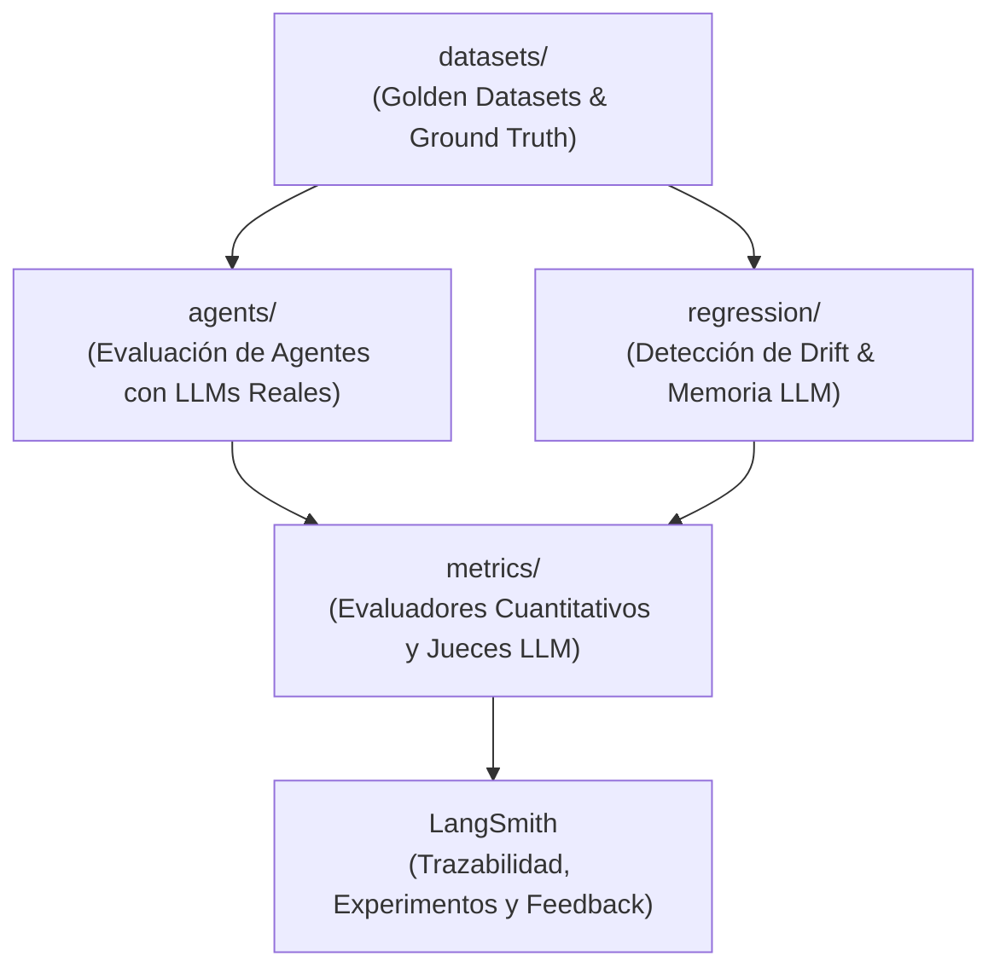

# Evaluación Agéntica y Semántica con LLMs — `tests/evals/`

[← Volver a tests/](../README.md)

---

## 🎯 Propósito y Finalidad

El directorio `tests/evals/` alberga el marco de evaluación empírica, semántica y cuantitativa para los componentes agénticos y modelos de lenguaje (LLMs) utilizados en el pipeline de importación masiva.

A diferencia del software convencional con salidas deterministas, los agentes basados en LLM (`MetadataCuratorAgent`, `SourceToGenericCrosswalkAgent`, `TargetCrosswalkAgent`, `DedupRecoveryAgent`) son probabilísticos. Este marco garantiza que:
1. **Modelos Reales sin Mocks:** Las capacidades de razonamiento, extracción, autorreparación y mapeo se midan directamente sobre los modelos configurados (Llama-3, DeepSeek, etc.) y no sobre mocks artificiales.
2. **Observabilidad en LangSmith:** Cada corrida queda instrumentada con trazas completas de ejecución, inspección de variables de entrada, salidas de referencia, herramientas invocadas, latencias y consumo de tokens.
3. **Control de Regresión y Schema Drift:** Se detecten caídas en el rendimiento provocadas por cambios en los prompts del sistema o modificaciones en las versiones de los modelos de los proveedores.
4. **Gestión de Costos y Eficiencia:** Se eviten re-ejecuciones innecesarias mediante políticas rigurosas de ejecución.

---

## 🧭 Estructura Metodológica de `tests/evals/`

La suite de evaluación se organiza en cuatro pilares complementarios:



- **[datasets/](datasets/README.md):** Conjuntos de datos declarativos estandarizados (`id_caso`, `inputs`, `reference_outputs`, `tags`), casos de sobrecorrección (*over-correction*), casos frontera y anomalías reales de extracción.
- **[agents/](agents/README.md):** Suites de evaluación sobre agentes individuales (`curator/`, `source_to_generic/`, `target_crosswalk/`, `dedup_recovery/`) implementando la arquitectura dual.
- **[metrics/](metrics/README.md):** Evaluadores deterministas, heurísticos y funciones evaluadoras para LangSmith (`(run, example) -> dict`) que califican la conformidad con los contratos de cada agente.

---

## 🧠 Heurísticas y Reglas de `agent-eval-creator`

El diseño e instrumentación de las evaluaciones se rige estrictamente por las heurísticas del rol de QA Semántico:

### 1. LLMs Reales, Sin Mocks
Se evalúa el comportamiento real del modelo configurado. Si se carece de una clave de API requerida en el entorno, el test debe omitirse con `pytest.skip` (o advertirse en logs), **nunca simularse con un mock**. Los mocks están reservados exclusivamente para `tests/unit/`.

### 2. Regla de Oro: No Ejecutar Dos Veces sin Cambios
Cada ejecución contra APIs de LLM consume cuota y tokens reales. Está prohibido re-ejecutar una evaluación si no hubo modificaciones en el código del agente, los prompts, las herramientas, los evaluadores o los datasets. Ante un fallo en una corrida previa, se debe analizar en primer lugar la traza ya registrada en LangSmith.

### 3. Arquitectura Dual de Evaluación (Issue #47)
- **Pytest + LangSmith (`test_<agent>_<aspect>.py`):**
  - Orientado a métricas **heterogéneas** entre casos.
  - Uso de fixtures locales (`tmp_path`, PDFs reales).
  - Aserciones duras (`assert`) que cortan la ejecución en CI cuando se violan contratos esenciales.
  - Registro en LangSmith mediante `@pytest.mark.langsmith` y métodos `log_inputs`, `log_outputs`, `log_feedback`.
- **LangSmith Nativo (`evaluate_<agent>_<aspect>.py` con `aevaluate`):**
  - Orientado a métricas **homogéneas** evaluadas de forma uniforme sobre todas las filas de un dataset.
  - Sincronización idempotente con datasets remotos de LangSmith (`sync_dataset_to_langsmith`).
  - Benchmarking cuantitativo masivo, visualización de matrices de confusión y comparación *side-by-side* de diferentes versiones de prompts o modelos.

### 4. Resultados Esperados Exhaustivos y Excluyentes
Cada caso de prueba declara explícitamente qué resultado es el correcto. Está prohibido el "verde por casualidad": no se acepta `A or B` si el contrato del agente espera exclusivamente uno de ellos.

### 5. Sin Métricas Vacías
No se incluyen métricas que el agente no pueda violar o que devuelvan siempre un valor aprobatorio por defecto. Si falta la referencia necesaria para evaluar una propiedad, el evaluador **omite** la métrica devolviendo `None`, nunca un valor aprobatorio artificial.

### 6. Inspección de Trayectoria de Herramientas
En agentes que disponen de tools (e.g., curador o enriquecimiento DOI en crosswalk), se evalúan las herramientas esperadas, las prohibidas y la cantidad de invocaciones para evitar bucles o llamadas indebidas.

### 7. Tipos de Score Admitidos
El score de evaluación depende de la propiedad medida, sin forzar rangos arbitrarios:
- **Booleano (`True / False`):** Invariantes críticas y validaciones pasa/falla.
- **Numérico (`float / int`):** Tasas de acierto, similitudes semánticas, distancias de edición o conteos.
- **Categórico (`str`):** Etiquetas de clasificación (e.g., `"correct" | "partial" | "wrong"`). En LangSmith se registra en `value` con score numérico asociado opcional.
- **`None`:** Métrica no aplicable al caso (se omite del reporte).

---

## 🔄 Flujo Metodológico de 6 Pasos para Diseñar Evaluaciones

```text
[Paso 1: Derivar Contrato] ➔ [Paso 2: Elegir Arquitectura] ➔ [Paso 3: Dataset Declarativo]
                                                                        ↓
[Paso 6: Verificación]    ←   [Paso 5: Suite Pytest/Nativo]   ← [Paso 4: Métricas/Evaluadores]
```

1. **Derivar el Contrato del Agente:** Especificar formalmente entradas, salidas, decisiones posibles, herramientas permitidas, modos de fallo e invariantes inquebrantables.
2. **Elegir la Arquitectura:** Decidir entre Pytest+LangSmith (heterogéneo / aserciones duras) o LangSmith nativo (homogéneo / benchmarking).
3. **Dataset Declarativo:** Construir el archivo JSON en `tests/evals/datasets/<agente>/` con entradas válidas y outputs de referencia exhaustivos.
4. **Evaluadores:** Definir funciones con firma `(run, example) -> dict` en `tests/evals/metrics/<agente>_metrics.py`.
5. **Suite:** Implementar los scripts de test o evaluación con trazabilidad a LangSmith.
6. **Verificación:** Ejecutar con control de costos y auditar trazas en la plataforma de observabilidad.

---

## 🚀 Cómo Ejecutar los Tests de Evaluación

### Configuración del Entorno:
```bash
export LANGSMITH_TRACING="true"
export LANGSMITH_ENDPOINT="https://api.smith.langchain.com"
export LANGSMITH_API_KEY="lsv2_pt_..."
export LANGSMITH_PROJECT="thesis-bulk-import-evals"
export OPENROUTER_API_KEY="sk-..."
export GROQ_API_KEY="gsk_..."
```

### Comandos de Pytest:
```bash
# 1. Ejecutar todas las evaluaciones agénticas
pytest tests/evals/ -m eval -v

# 2. Ejecutar suite de un agente particular
pytest tests/evals/agents/curator/ -v
pytest tests/evals/agents/dedup_recovery/ -v
```

### Comandos de LangSmith Nativo (`aevaluate`):
```bash
# Benchmarks continuos
.venv/bin/python tests/evals/agents/curator/evaluate_curator_decisions.py
.venv/bin/python tests/evals/agents/source_to_generic/evaluate_source_mapping.py
.venv/bin/python tests/evals/agents/target_crosswalk/evaluate_target_crosswalk_mapping.py
.venv/bin/python tests/evals/agents/dedup_recovery/evaluate_dedup_recovery.py
```

---

## 📦 Matriz de Costos Estimada

| Evaluación | Modelo Típico | Duración | Costo Aprox. | Cuándo Ejecutar |
|:---|:---|:---:|:---:|:---|
| **Curador (Over-correction & Decisions)** | Llama-3-70B | ~2 - 3 min | ~$0.10 | Al modificar prompts o lógica OCR |
| **Crosswalk Fuente a Genérico** | Llama-3.1-8B / 70B | ~1 - 2 min | ~$0.05 | Al actualizar mapeos o herramientas DOI |
| **Crosswalk Genérico a Destino** | Llama-3-70B | ~1 - 2 min | ~$0.05 | Al agregar esquemas o lógica de reparación |
| **Recuperación Reactiva (CBR + LLM)** | Llama-3.3-70B / 8B | ~45 seg | ~$0.03 | Al modificar prompts o estrategias de error |
