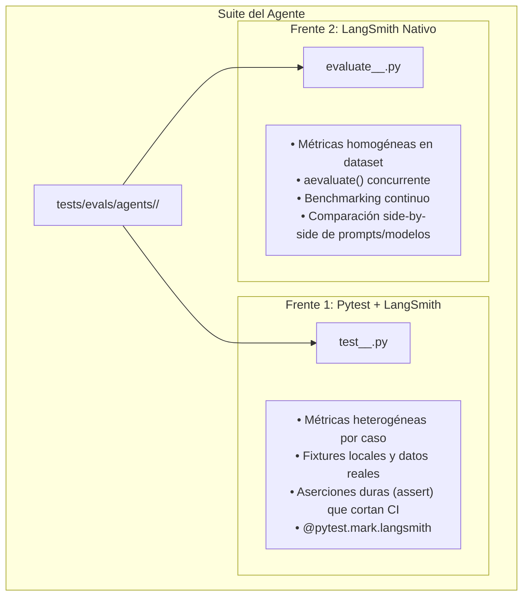

# Evaluación de Agentes LLM — `tests/evals/agents/`

[← Volver a tests/evals/](../README.md)

---

## 🎯 Propósito y Finalidad

El directorio `tests/evals/agents/` alberga las suites de evaluación semántica, conductual y cuantitativa para los agentes autónomos basados en modelos de lenguaje (LLMs) reales que operan en el pipeline de importación masiva:

1. **`MetadataCuratorAgent` (`curator/`):** Curación semántica de metadatos bibliográficos extraídos de PDFs mediante OCR, eliminando artefactos y resolviendo inconsistencias.
2. **`SourceToGenericCrosswalkAgent` (`source_to_generic/`):** Inferencia conceptual del mapeo entre columnas heterogéneas de entrada (e.g., Springer, SciELO, UNLP) y el esquema canónico intermedio del pipeline.
3. **`TargetCrosswalkAgent` (`target_crosswalk/`):** Transformación desde el esquema intermedio hacia los esquemas destino institucionales (SEDICI y DSpace), generación dinámica y autorreparación de configuraciones erróneas provistas por el usuario.
4. **`DedupRecoveryAgent` (`dedup_recovery/`):** Diagnóstico y autorreparación reactiva de errores de deduplicación asistida por Memoria Episódica (CBR), validación transaccional sobre CSV y calibración de escalamiento humano (HITL).

A diferencia de las pruebas unitarias que utilizan mocks, aquí **se evalúan modelos LLM reales (sin mocks)**, observando el razonamiento, la trayectoria de herramientas y la calidad de la salida con trazabilidad total en **LangSmith**.

---

## 🏛️ Arquitectura Dual de Evaluación (Issue #47)

Siguiendo las heurísticas metodológicas de `agent-eval-creator`, cada agente implementa una estrategia complementaria de doble frente:



---

## 🤖 Agentes Evaluados y Cobertura de Suites

### 1. `curator/` — Agente de Curación de Metadatos
Evalúa la toma de decisiones, la preservación de información válida y la corrección de errores de OCR en metadatos bibliográficos:

- **`test_curator_over_correction.py` (Pytest + LangSmith):**
  - **Objetivo:** Garantizar que el agente **no sobrecorrija** ni introduzca alucinaciones cuando se le presentan metadatos limpios y válidos (tasa de sobrecorrección $\approx 0\%$).
  - **Dataset:** [`curator_clean_baseline.json`](../datasets/README.md#curator_clean_baselinejson-15-casos) (15 casos).
- **`test_curator_decisions.py` (Pytest + LangSmith):**
  - **Objetivo:** Verificar el ruteo de decisiones (reparar campo afectado, abstenerse o escalar a HITL), conservación exacta de campos no afectados y control de herramientas requeridas vs. prohibidas.
  - **Dataset:** [`curator_decision_cases.json`](../datasets/README.md#curator_decision_casesjson-8-casos) (8 casos).
- **`evaluate_curator_decisions.py` (LangSmith Nativo):**
  - **Objetivo:** Benchmark cuantitativo global mediante `aevaluate` para comparar la precisión de decisiones del agente ante diferentes temperaturas o modelos de lenguaje.

### 2. `source_to_generic/` — Agente Crosswalk Fuente a Genérico
Evalúa la interpretación semántica de encabezados tabulares desconocidos y su alineación con el esquema intermedio:

- **`test_source_doi_enrichment_trajectory.py` (Pytest + LangSmith):**
  - **Objetivo:** Evaluar la trayectoria y uso de herramientas (`doi_lookup` en Crossref / OpenAlex) para enriquecer o desambiguar metadatos incompletos.
  - **Dataset:** [`source_doi_enrichment_cases.json`](../datasets/README.md#source_doi_enrichment_casesjson-7-casos) (7 casos).
- **`test_source_feedback_recovery.py` (Pytest + LangSmith):**
  - **Objetivo:** Evaluar la resiliencia y autorreparación del agente ante mensajes de error o feedback de validación (e.g., columnas obligatorias omitidas).
  - **Dataset:** [`source_feedback_recovery_cases.json`](../datasets/README.md#source_feedback_recovery_casesjson-5-casos) (5 casos).
- **`test_source_regex_react.py` (Pytest + LangSmith):**
  - **Objetivo:** Evaluar el razonamiento ReAct para formular y aplicar expresiones regulares de extracción ante columnas compuestas (e.g., fecha, volumen y número amalgamados).
  - **Dataset:** [`source_regex_react_cases.json`](../datasets/README.md#source_regex_react_casesjson-6-casos) (6 casos).
- **`evaluate_source_mapping.py` (LangSmith Nativo):**
  - **Objetivo:** Medir sistemáticamente la precisión global de mapeo campo a campo (`field_mapping_accuracy`) y confianza sobre fuentes heterogéneas.
  - **Dataset:** [`source_mapping_cases.json`](../datasets/README.md#source_mapping_casesjson-10-casos) (10 casos).

### 3. `target_crosswalk/` — Agente Crosswalk Genérico a Destino
Evalúa la proyección del esquema canónico a las especificaciones formales de esquemas institucionales:

- **`test_target_crosswalk_formats.py` (Pytest + LangSmith):**
  - **Objetivo:** Verificar la compatibilidad con formatos de destino soportados (SEDICI, DSpace) y la generación dinámica de esquemas destino.
- **`test_target_crosswalk_user_repair.py` (Pytest + LangSmith):**
  - **Objetivo:** Evaluar la capacidad del agente para validar, reparar y reconciliar configuraciones de destino imperfectas provistas por el usuario (`user-provided target config repair`).
- **`evaluate_target_crosswalk_mapping.py` (LangSmith Nativo):**
  - **Objetivo:** Benchmark de mapeo exhaustivo con `aevaluate` sobre el dataset [`target_crosswalk_cases.json`](../datasets/README.md#target_crosswalk_casesjson-7-casos) (7 casos).

### 4. `dedup_recovery/` — Agente de Recuperación Reactiva (CBR + HITL)
Evalúa la resolución autónoma de incidentes de deduplicación, el impacto de la Memoria Episódica y el escalamiento conservador ante ambigüedad:

- **`test_dedup_recovery_decisions.py` (Pytest + LangSmith):**
  - **Objetivo:** Evaluar con aserciones duras y métricas condicionales (`eval_strategy_params_validity`, `eval_episodic_memory_effect`, `eval_csv_repair_execution`) la validez de parámetros (`mapping_rules`, `regex_pattern`), la transferencia/discriminación de episodios en memoria y la reparación física del CSV bajo `CsvTransaction`.
  - **Dataset:** [`dedup_recovery_cases.json`](../datasets/README.md#dedup_recovery_casesjson-8-casos) (8 casos).
- **`evaluate_dedup_recovery.py` (LangSmith Nativo):**
  - **Objetivo:** Benchmark homogéneo con `aevaluate` empleando exclusivamente `DEDUP_RECOVERY_EVALUATORS` (100% de cobertura en todas las filas sin celdas `"No Feedback"`).

---

## 🚀 Cómo Ejecutar las Evaluaciones

> [!IMPORTANT]
> Se requiere configurar las API keys de los proveedores de LLM (`GROQ_API_KEY`, `OPENROUTER_API_KEY`, `NVIDIA_API_KEY`, etc.) y las variables de observabilidad de LangSmith:
> ```bash
> export LANGSMITH_TRACING="true"
> export LANGSMITH_API_KEY="lsv2_pt_..."
> export LANGSMITH_PROJECT="thesis-bulk-import-evals"
> ```

### Ejecución de Pruebas Pytest + LangSmith:
```bash
# 1. Ejecutar todas las evaluaciones agénticas Pytest
pytest tests/evals/agents/ -v

# 2. Ejecutar un agente específico (ej. curador o recuperación reactiva)
pytest tests/evals/agents/curator/ -v
pytest tests/evals/agents/dedup_recovery/ -v

# 3. Ejecutar solo pruebas de over-correction del curador
pytest tests/evals/agents/curator/test_curator_over_correction.py -v

# 4. Ejecutar pruebas de trayectoria de tools en crosswalk
pytest tests/evals/agents/source_to_generic/test_source_doi_enrichment_trajectory.py -v
```

### Ejecución de Evaluaciones Nativas de LangSmith (`aevaluate`):
```bash
# 1. Ejecutar benchmark nativo del curador
.venv/bin/python tests/evals/agents/curator/evaluate_curator_decisions.py

# 2. Ejecutar benchmark de mapeo fuente a genérico
.venv/bin/python tests/evals/agents/source_to_generic/evaluate_source_mapping.py

# 3. Ejecutar benchmark de crosswalk a destino y reparación de usuario
.venv/bin/python tests/evals/agents/target_crosswalk/evaluate_target_crosswalk_mapping.py

# 4. Ejecutar benchmark homogéneo del agente de recuperación reactiva
.venv/bin/python tests/evals/agents/dedup_recovery/evaluate_dedup_recovery.py
```

---

## 📦 Dependencias y Costos

| Agente / Aspecto | Modelo Típico | Duración | Costo Aprox. (Tokens) | Trazabilidad |
|:---|:---|:---:|:---:|:---:|
| **Curator (Over-correction)** | Llama-3-70B / DeepSeek-V3 | ~1.5 - 2 min | ~$0.08 | LangSmith Run / Pytest report |
| **Curator (Decisiones & Tools)** | Llama-3-70B | ~1 - 2 min | ~$0.06 | LangSmith Run / Pytest report |
| **Source to Generic (Mapping)** | Llama-3.1-8B-Instant / 70B | ~45 - 90 seg | ~$0.04 | LangSmith Dataset Experiment |
| **Source to Generic (DOI/Regex)** | Llama-3-70B | ~1 - 2 min | ~$0.05 | LangSmith Run / Pytest report |
| **Target Crosswalk (Repair)** | Llama-3-70B | ~1 - 2 min | ~$0.05 | LangSmith Run / Pytest report |
| **Dedup Recovery (CBR & HITL)** | Llama-3.3-70B / 8B | ~30 - 60 seg | ~$0.03 | LangSmith Dataset / Pytest report |
